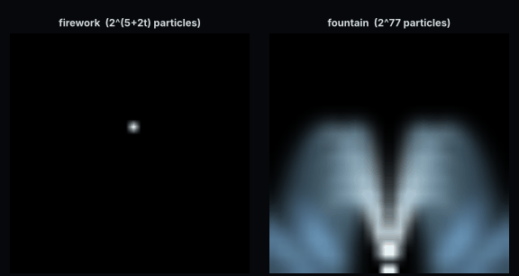
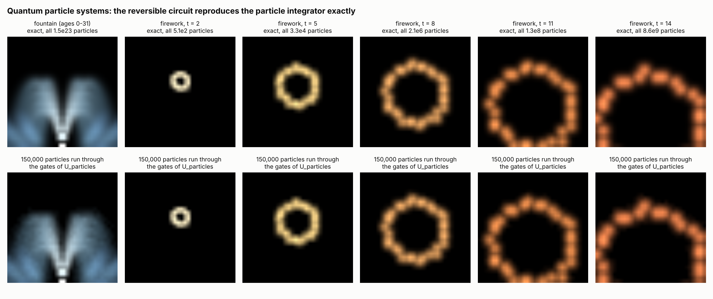
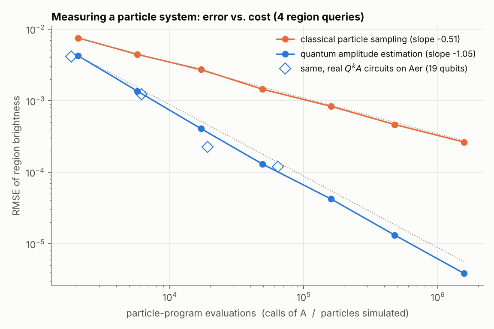
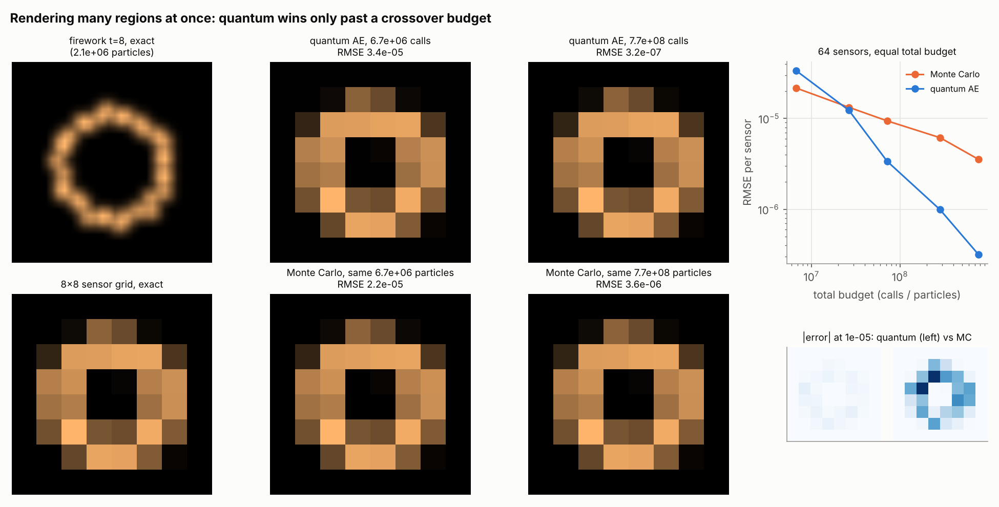
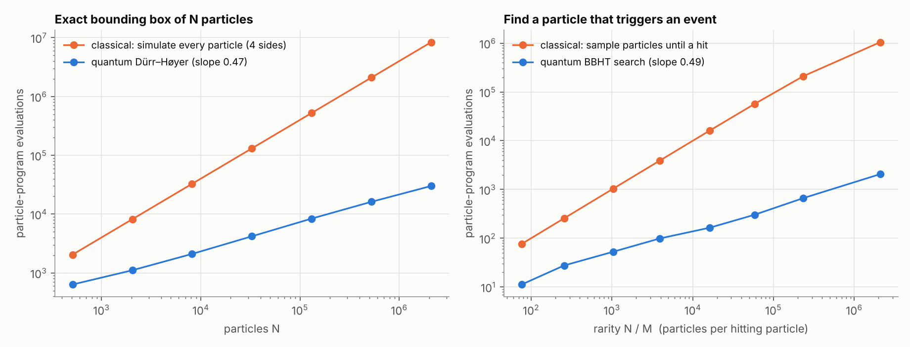

# Quantum Ray Tracing, Ray Marching & Particle Systems in Qiskit

Replications of two quantum-rendering papers, plus an original **quantum particle
system** (section 3). Everything is built with
**Qiskit 2.6 + Qiskit Aer 0.18**, managed with **uv**, and checked by a pytest suite
and by rendered images.

| Paper | What we replicate | Quantum advantage measured |
|---|---|---|
| L. P. Santos, T. Bashford-Rogers, J. Barbosa, P. Navrátil, *Towards Quantum Ray Tracing*, [arXiv:2204.12797](https://arxiv.org/abs/2204.12797) (2022) | Grover / BBHT `QSearch` and Dürr–Høyer minimum finding for closest-hit and shadow rays in a padded "Qornell box" | Intersection evaluations per ray grow as **O(√N)** instead of O(N) |
| L. Mosier, M. McGuire, T. Hachisuka, *Quantum Ray Marching for Reformulating Light Transport Simulation*, SIGGRAPH Asia 2023, [doi:10.1145/3610548.3618151](https://doi.org/10.1145/3610548.3618151) | Fully reversible quantum-walk ray marcher on an 8×8 voxel grid (Init, Shift, Sample, Coin, Path gates), followed by amplitude estimation | Light-transport integral error falls as **O(1/N)** instead of Monte Carlo's O(1/√N) |
| *New:* quantum particle systems (QPS), this repo | One reversible circuit integrates every particle of a fountain or firework at once (2⁷⁷ particles in 167 qubits), then amplitude estimation, Dürr–Høyer and BBHT query it | Region brightness error **O(1/M)** vs O(1/√M); bounding box **O(√N)** vs O(N); event search **O(√(N/M))** vs O(N/M) |

All quantum results are **simulated**. "Speedup" here means *query complexity*: the
number of oracle or circuit evaluations, which is the metric both papers use. It does not
mean wall-clock time on today's hardware.

## Quick start

```bash
uv sync
uv run pytest              # 76 tests (add -m "not slow" to skip the slower MPS/Aer tests)
uv run qrt-experiments     # ray tracing / ray marching figures (about 15 min on 4 cores; --quick)
uv run qps-experiments     # particle-system figures (about 21 min, 20 of them real Aer Q^k A runs; --quick)
```

## Results

### 1. Grover intersection search (Santos et al.)


Each primary ray uses Dürr–Høyer minimum finding over all `N` primitives to find the
closest hit. Each shadow ray uses `QSearch` (BBHT exponential search, `c = 1.2`) for any
occluder. Costs are counted as in the paper: `#Int = #Eval (Grover iterations) + #C_Int
(classical checks of measured candidates)`. The scene has 16 real primitives, padded with
dummy primitives up to N = 512, as in the paper's 8→512 sweep.

| N | classical tests/ray | quantum evals/ray | image NRMSE |
|---:|---:|---:|---:|
| 16 | 16 | 29.0 | 0.009 |
| 64 | 64 | 57.2 | 0.006 |
| 128 | 128 | 80.8 | 0.007 |
| 256 | 256 | 110.1 | 0.006 |
| 512 | 512 | **154.9** | 0.008 |

The fitted log-log slope is **0.48**, against 0.5 for √N (≈ 7.1·√N). The quantum method
becomes cheaper than exhaustive testing from N = 64 onward. Santos et al. report 33.6
evals/ray at N = 64 for their own scene and parameters, and the same crossover trend.


The fourth panel was rendered by **executing real Grover circuits on Qiskit Aer**:
147,494 circuits, one shot each, at 64×64 with N = 64. It matches the reference with
NRMSE 0.013. The few wrong pixels come from two sources:

- **Probabilistic Grover misses** (dark specks), the noise source the paper studies.
- **Ties at polygon edges**, where two primitives sit at the same distance. This is the
  "Z-fighting" the paper also reports.

### 2. Quantum ray marching (Mosier, McGuire & Hachisuka)

The circuit `A` (see [`qrm.py`](src/quantum_ray_tracing/qrm.py)) follows the paper's
Fig. 2/3 pipeline:

1. **Init** basis-encodes the start voxel and a superposition of start directions.
2. Each step applies:
   - **Shift**: controlled modular ±1 adders on the x/y registers, for 8 compass directions.
   - **Sample**: uniformly-controlled R_y gates amplitude-encode `Le` and `ρ` of the current voxel.
   - **Coin**: position-dependent Lambertian scattering.
3. **Path** uses a `|Steps⟩` register and multi-controlled X gates to produce
   `P(out=1) = (1/s) Σᵢ Leᵢ Πₖ<ᵢ ρₖ`, averaged over *every* path in superposition (Eq. 15).

| walk steps | qubits | depth (cx+u) | CNOTs |
|---:|---:|---:|---:|
| 1 | 11 | 923 | 541 |
| 2 | 20 | 5,837 | 3,488 |
| 3 | 28 | 10,729 | 6,485 |
| 4 | 35 | 15,611 | 9,474 |

**Exactness.** The full 8×8 × RGB light map was computed *from the circuits themselves*:

- 2 steps: Aer statevector, 20 qubits.
- 3 steps: Aer matrix-product-state, 28 qubits. This is the paper's exact 2-D configuration.

Both match the classical exponential-branching emulator to **1e-15** and **3e-11**
respectively. Tests also confirm the match with random materials everywhere, and for
4-step walks (35 qubits).


**Speedup.** The amplitude is read out with **Iterative Amplitude Estimation** (IQAE;
α = 10⁻³, 32 shots per round). IQAE uses Grover powers `Q^k A` and no phase estimation,
the same family as the Nakaji / Shimada–Hachisuka method used in the paper. Cost is the
paper's metric: the number of times the ray-marching circuit `A` is applied (`2k+1` per
shot of `Q^k A`), compared with one path per classical MC sample.


- Over six voxels × 100 trials, quantum RMSE falls with slope **−0.99** and Monte Carlo with
  **−0.50**.
- At 4.1×10⁵ evaluations the quantum error is 2.0×10⁻⁵. Monte Carlo would need about
  **1.7×10⁸ paths (≈ 426× more)** to match it, and the gap keeps widening as `√N`.
- The hollow diamonds run the *same algorithm on real `Q^k A` circuits on Aer*: the 1-step
  QRM walk on 11 qubits, Grover powers up to k = 345. They follow the same 1/N line.
- A 20-qubit 2-step walk run with real Grover circuits estimates F = 0.1253 (exact 0.1250)
  using 5,312 circuit calls.


At an equal budget of about 29k calls per voxel, the quantum light map has **6.4× lower
RMSE** for the 3-step walk (1.1e-4 vs 7.3e-4) and **3.2× lower** for 8 steps (2.8e-4 vs
9.1e-4). At small budgets (≈10³ calls) the two methods are comparable. Mosier et al.
likewise note that their quantum error "starts higher than classical MC" on low-variance
scenes, and that the advantage is asymptotic.

### 3. Quantum particle systems (new)



Ray tracing has a vendor racing to solve it. Particle systems (sparks, spray, smoke,
fireworks) are built by everyone else, so this section proposes a quantum particle
system that anyone can drop a quantum computer into. The module is
[`particles.py`](src/quantum_ray_tracing/particles.py).

**The idea in one line.** A particle system is a *program of its random seed*: each
particle draws a spawn offset, a velocity, an age and per-step turbulence from random
bits, and then a fixed integrator moves it. So we build

```
A  =  Readout · U_particles · H^{⊗ n_seed}
```

- **`H^{⊗ n_seed}`**: a uniform superposition over all seeds. Each basis state *is one
  particle*. The fountain has 77 seed qubits, so **2⁷⁷ ≈ 1.5×10²³ particles**.
- **`U_particles`**: a purely classical reversible circuit (X and multi-controlled X only).
  It runs the whole particle program in fixed-point two's-complement arithmetic:
  - **emitter**: velocity look-up table (QROM) and spawn offset;
  - **forces**: gravity and wind;
  - **turbulence**: a fresh coin qubit per step, kicking velocity or position;
  - **integration**: semi-implicit Euler, `v += a; p += v`;
  - **collision**: a reversible floor **bounce**, `y ← −y`, `vy ← −vy − loss`, with one
    which-step flag qubit;
  - **continuous emission**: an **age register** in superposition, decoded to "alive"
    flags, so one circuit holds particles of every age.

  **Its size is that of integrating one particle and does not depend on N.** A test
  checks that 64× more particles adds zero gates.
- **`Readout`**: marks a set of pixels (a sensor, a camera window, a collider) and
  rotates an intensity qubit by the particle's age-dependent colour (a uniformly
  controlled R_y on the age register). Then

  `P(objective = 1) = (1/N) Σ_particles colour_c(age) · [particle in region]`,

  which is exactly that region's splatted brightness.

| system | qubits | seed qubits = log₂ N | gates in `U_particles` | max controls |
|---|---:|---:|---:|---:|
| tiny burst (Aer `Q^k A` runs) | 18 | 4 | 70 | 4 |
| firework, t = 8 | 53 | 21 | 1,207 | 9 |
| firework, t = 12 | 61 | 29 | 1,691 | 9 |
| fountain, ages 0–31, bounce | 167 | 77 | 6,129 | 11 |

**The circuit *is* the particle system.** Fig. 6 compares two renderings of each frame:

- **Top row**: the exact expected image over *all* particles, from a classical dynamic
  program over the seed distribution.
- **Bottom row**: 150,000 random particles pushed through the **actual gates** of
  `U_particles` by a gate-level permutation simulator.

Over 900,000 particles there are **0 mismatches** against the classical integrator. The
tests add more checks:

- all **2²⁰ particles** of a stream with bounce, jitter and ages, checked exhaustively;
- the full `A` (Hadamards + gates + R_y readout) on Aer statevector: `P(objective=1)`
  matches the exact brightness to 1e-10 for counts, RGB channels and stream colours.



#### Three quantum queries on one particle circuit

Cost is counted, as in sections 1–2, in **particle-program evaluations**:

- **quantum**: calls of `A` (one call = one run of the circuit; a Grover oracle step costs
  the same up to a constant 2 for uncompute);
- **classical**: particles simulated.

**(a) Measure / render a region: amplitude estimation.** Four queries:

- splash on the fountain's basin floor (green channel);
- spray above head height (particle count);
- firework light on a 4×4-pixel sensor (red channel);
- firework sparks below the horizon (count).

Each is estimated with IQAE (α = 10⁻³, 32 shots), compared with classical Monte Carlo
splatting at the same number of evaluations.



- **Error slopes:** quantum **−1.05**, Monte Carlo **−0.51**, averaged over 4 queries ×
  100 trials.
- **Reaching the same error:** at 1.6×10⁶ calls the quantum RMSE is 3.8×10⁻⁶. Monte Carlo
  would need about **7.6×10⁹ particles (≈ 4,800× more)** to match.
- **Real circuits:** the diamonds run IQAE on **real `Q^k A` circuits on Aer**, using the
  19-qubit tiny burst with Grover powers up to k = 362. They follow the same 1/M line.
  Their errors are rescaled by √(a(1−a)) to the mean amplitude of the four queries,
  because IQAE's amplitude error is proportional to that factor.

**(b) Many regions at once: an honest crossover.**

*Why the per-region approach can lose.* One classical particle lands in one pixel and so
updates the whole image at once. Amplitude estimation, as used here, estimates **one
region per run**.

*The fair test.* Fig. 8 renders an 8×8 grid of light sensors over the firework (64
regions × 3 channels). Monte Carlo gets the **total** quantum budget.



| total budget | quantum RMSE | MC RMSE | MC / quantum |
|---:|---:|---:|---:|
| 6.7×10⁶ | 3.4e-05 | 2.2e-05 | 0.64 (MC wins) |
| 2.7×10⁷ | 1.2e-05 | 1.3e-05 | 1.1 (crossover) |
| 7.2×10⁷ | 3.4e-06 | 9.4e-06 | 2.8 |
| 2.8×10⁸ | 9.9e-07 | 6.1e-06 | 6.2 |
| 7.7×10⁸ | 3.2e-07 | 3.6e-06 | **11.1** |

*Where the crossover lands.* With R regions the crossover budget grows roughly as R². A
full 32×32-pixel frame done pixel by pixel lost by about 5× at the 10⁻³ precision in our
trial. **Quantum particle rendering therefore pays off today for**:

- scalar or few-region measurements: coverage, "how much spray hits the windshield",
  light on a sensor, the energy reaching a surface;
- coarse probe grids at high precision.

It does not yet pay off for full-resolution frames. The route to full frames is to
estimate all pixels jointly. van Apeldoorn, Cornelissen, Gilyén & Nannicini
([SODA 2023, arXiv:2207.08800](https://arxiv.org/abs/2207.08800)) estimate many
expectation values with Õ(√‖Σⱼ Eⱼ²‖ / ε) uses of the state-preparation unitary.
Disjoint pixel projectors have ‖Σⱼ Eⱼ²‖ ≤ 1, so this suggests Õ(1/ε) calls of `A` for
the whole frame. That is the main next step.

**(c) and (d): bounds and events with Grover.** These reuse the Dürr–Høyer and BBHT code
from section 1. The oracle compares the output of `U_particles` with a threshold; the
seed register is the search index.



- **Exact bounding box** of N firework particles (4 extremal queries). The cost grows
  with slope **0.47**, against 4N for simulating every particle:
  - at N = 2.1×10⁶ it takes 30,053 evaluations instead of 8.4×10⁶;
  - it was exact in 100% of 700 queries.

  Bounding boxes drive culling, acceleration structures and adaptive time steps.
- **Event search**: find a particle that triggers a collider or sub-emitter when only M
  of N do. Slope **0.49** in N/M:
  - at N/M ≈ 2.3×10⁵ it needs 663 evaluations, against about 2.1×10⁵ classical draws;
  - for a single hitting particle among 2.1×10⁶ it needs 2,063 against about 10⁶.

**Why this is a good target for early quantum computers.**

- **Simple circuit:** `U_particles` is nothing but X and multi-controlled X gates, the
  cheapest kind of quantum logic.
- **No interference to engineer:** paths never interfere, and the quantum part sits
  entirely in the standard amplitude-amplification wrappers.
- **Additive design:** any new force, collider, emitter shape or colour ramp is a
  reversible subroutine added to the same program.

**Not claimed.**

- **No wall-clock speedup:** as with sections 1–2, everything is simulated and costs are
  query counts.
- **Exact amplitudes in sampled sweeps:** the IQAE and Grover sweeps sample the ideal
  output law using exact amplitudes and marked sets. Those come from the exact DP and the
  per-particle integrator, which the tests show equal the circuit. The Aer diamonds and
  the `Q^k A` test show real circuits follow that law.
- **Exact Monte Carlo statistics:** Monte Carlo error bars use the exact law of one
  particle's contribution (multinomial draws). A test checks that law against really
  simulated particles.
- **No interactions:** particles do not interact with each other (no particle-particle
  collisions, flocking or SPH). Those are open problems for a superposition-of-seeds
  design.

## How this maps onto the papers, and where it differs

- **Grover oracle.** As in Santos et al., the per-primitive hit predicate comes from a
  classical table (their ray-plane coordinates are also computed classically, which they
  note is O(N)). We build the phase oracle from the marked set. The √N advantage therefore
  holds in oracle queries, exactly as they claim it.
- **Exact vs executed Grover.** Large renders use `ExactGroverBackend`, which samples the
  exact output distribution of the ideal circuit (`sin²((2r+1)θ)`). Tests check this against
  Aer, and fig. 2 also shows a full render from real circuits.
- **Reversible coin.** The paper makes the Lambertian coin unitary by "shuffling the signs
  of the amplitudes". We instead record the incoming direction in a fresh which-path
  register: 2 coin qubits plus 3 garbage qubits per bounce, followed by a CSWAP. Paths
  therefore never interfere, and the objective probability *equals* the exact path
  integral, which the tests verify. The scattering lobe is {n−45°, n, n, n+45°} with
  weights ¼, ½, ¼, a discrete cosine-like distribution.
- **Amplitude estimation.** The paper uses Nakaji's Faster AE. We use IQAE (same family,
  with rigorous confidence intervals). We also ship MLAE (Suzuki et al.): its *median* error
  scales as 1/N, but rare alias failures made its RMSE erratic at 16–32 shots, so we switched.
- **What is simulated vs emulated.** Light maps up to 3 steps (fig. 3, top) are computed
  from the circuits. The 8-step maps use the exact classical branching emulator, just as
  the paper's 3-D results use an "emulated" mode. The large convergence sweeps sample the
  ideal amplification law `sin²((2k+1)θ)`, with θ taken from the circuit amplitude; the Aer
  diamonds show real circuits reproduce it.
- **Not claimed.** No wall-clock speedup. Like the paper (§6), we make no claim that ray
  marching itself is faster than classical: the walk's cost per path matches a classical
  marcher. The gain comes from amplitude estimation over the superposition of all paths.

## Engineering notes

- Aer's `matrix_product_state` method runs the 28- and 35-qubit walk circuits in about a
  second; statevector took 220 s for 28 qubits. Grover reflections make MPS useless for
  `Q^k`, so amplitude estimation on real circuits uses the ≤ 20-qubit walks.
- Aer 0.18 segfaults when it runs a circuit stitched from compiled pieces that contain its
  `multiplexer` instruction. `AerAmplitudeSampler._compile` expands it.
- Per-ray Grover circuits are sent to Aer without transpiling (H, X, MCX and measure are
  native). This is about 50× faster.

## Layout

```
src/quantum_ray_tracing/
  grover.py               Grover oracle/diffuser, exact & Aer backends, QSearch, Dürr–Høyer
  scene3d.py              Qornell box, classical & Grover ray tracers, NRMSE / #Dpix
  amplitude_estimation.py Grover operator Q, Aer & exact samplers, IQAE, MLAE
  qrm.py                  2-D voxel scene, quantum ray-marching circuit, exact emulator, MC
  experiments.py          all figures + results/results.json  (qrt-experiments)
  particles.py            quantum particle systems: reversible particle program, readout,
                          exact DP, per-particle integrator, gate-level permutation simulator
  particle_experiments.py fig6-fig9, qps_firework.gif, results/qps_results.json  (qps-experiments)
tests/                    76 tests: circuits vs closed forms, circuit vs emulator, scaling laws
results/                  generated figures and numbers
```

## Ideas for next steps

- Implement Santos et al.'s coherent comparator oracle (integer ray-plane coordinates),
  so the Grover oracle is a genuine reversible circuit.
- Add the specular coin and a 3-D voxel walk (3 position registers, 26 directions).
- Run noisy simulations (Aer noise models) to see where the 1/N regime breaks down.
- Replace IQAE with Nakaji's Faster AE for an exact match to the paper's estimator.
- QPS: implement joint multi-region estimation (van Apeldoorn et al. 2023) for full frames
  with O(1/ε) total calls, then 3-D particles, sub-pixel colour, and motion-blur trails
  (an age window in superposition).
