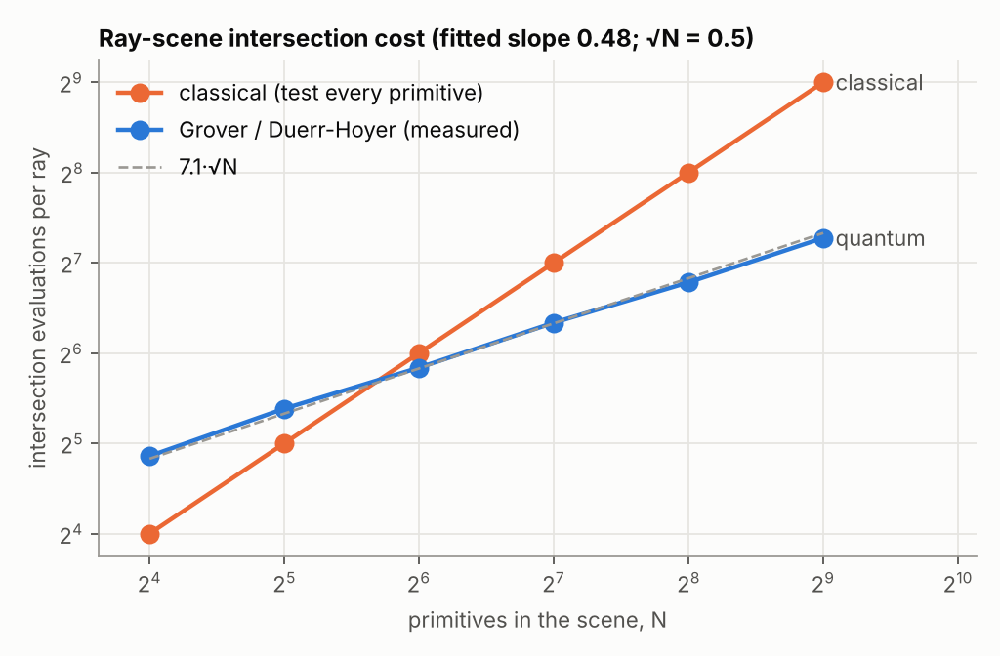
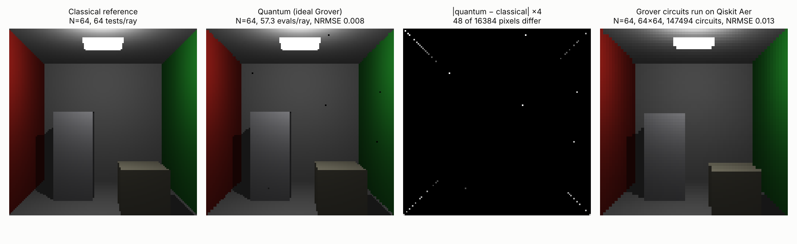
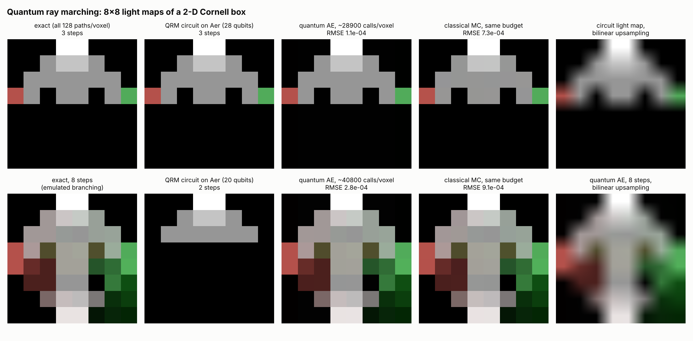
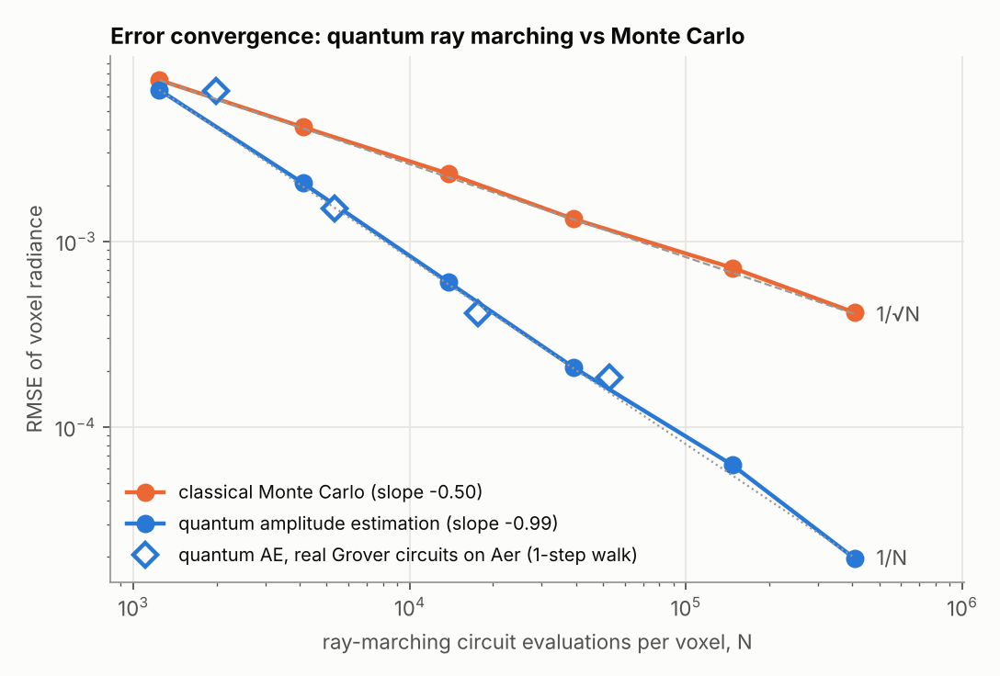
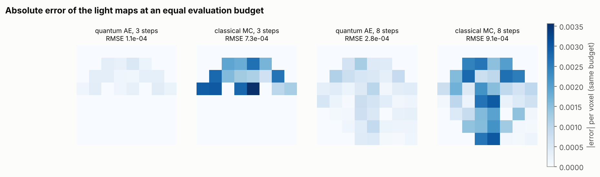

# Quantum Ray Tracing & Quantum Ray Marching in Qiskit

Replications of two quantum-rendering papers, plus extensions. Everything is built with
**Qiskit 2.6 + Qiskit Aer 0.18**, managed with **uv**, and checked by a pytest suite
and by rendered images.

| Paper | What we replicate | Quantum advantage measured |
|---|---|---|
| L. P. Santos, T. Bashford-Rogers, J. Barbosa, P. Navrátil, *Towards Quantum Ray Tracing*, [arXiv:2204.12797](https://arxiv.org/abs/2204.12797) (2022) | Grover / BBHT `QSearch` and Dürr–Høyer minimum finding for closest-hit and shadow rays in a padded "Qornell box" | Intersection evaluations per ray grow as **O(√N)** instead of O(N) |
| L. Mosier, M. McGuire, T. Hachisuka, *Quantum Ray Marching for Reformulating Light Transport Simulation*, SIGGRAPH Asia 2023, [doi:10.1145/3610548.3618151](https://doi.org/10.1145/3610548.3618151) | Fully reversible quantum-walk ray marcher on an 8×8 voxel grid (Init, Shift, Sample, Coin, Path gates), followed by amplitude estimation | Light-transport integral error falls as **O(1/N)** instead of Monte Carlo's O(1/√N) |

All quantum results are **simulated**. "Speedup" here means *query complexity*: the
number of oracle or circuit evaluations, which is the metric both papers use. It does not
mean wall-clock time on today's hardware.

## Quick start

```bash
uv sync
uv run pytest              # 50 tests (add -m "not slow" to skip the ~20 s MPS/Aer-render tests)
uv run qrt-experiments     # regenerates results/ (about 15 min on 4 cores; --quick for a shorter run)
```

## Results

### 1. Grover intersection search (Santos et al.)



Each primary ray uses Dürr–Høyer minimum finding over all `N` primitives to find the
closest hit. Each shadow ray uses `QSearch` (BBHT exponential search, `c = 1.2`) for any
occluder. Costs are counted as in the paper: `#Int = #Eval (Grover iterations) + #C_Int
(classical checks of measured candidates)`. The scene has 16 real primitives, padded with
dummy primitives up to N = 512, as in the paper's 8→512 sweep.

| N | classical tests/ray | quantum evals/ray | image NRMSE |
|---:|---:|---:|---:|
| 16 | 16 | 29.0 | 0.009 |
| 64 | 64 | 57.2 | 0.006 |
| 128 | 128 | 80.8 | 0.007 |
| 256 | 256 | 110.1 | 0.006 |
| 512 | 512 | **154.9** | 0.008 |

The fitted log-log slope is **0.48**, against 0.5 for √N (≈ 7.1·√N). The quantum method
becomes cheaper than exhaustive testing from N = 64 onward. Santos et al. report 33.6
evals/ray at N = 64 for their own scene and parameters, and the same crossover trend.



The fourth panel was rendered by **executing real Grover circuits on Qiskit Aer**:
147,494 circuits, one shot each, at 64×64 with N = 64. It matches the reference with
NRMSE 0.013. The few wrong pixels come from two sources:

- **Probabilistic Grover misses** (dark specks), the noise source the paper studies.
- **Ties at polygon edges**, where two primitives sit at the same distance. This is the
  "Z-fighting" the paper also reports.

### 2. Quantum ray marching (Mosier, McGuire & Hachisuka)

The circuit `A` (see [`qrm.py`](src/quantum_ray_tracing/qrm.py)) follows the paper's
Fig. 2/3 pipeline:

1. **Init** basis-encodes the start voxel and a superposition of start directions.
2. Each step applies:
   - **Shift**: controlled modular ±1 adders on the x/y registers, for 8 compass directions.
   - **Sample**: uniformly-controlled R_y gates amplitude-encode `Le` and `ρ` of the current voxel.
   - **Coin**: position-dependent Lambertian scattering.
3. **Path** uses a `|Steps⟩` register and multi-controlled X gates to produce
   `P(out=1) = (1/s) Σᵢ Leᵢ Πₖ<ᵢ ρₖ`, averaged over *every* path in superposition (Eq. 15).

| walk steps | qubits | depth (cx+u) | CNOTs |
|---:|---:|---:|---:|
| 1 | 11 | 923 | 541 |
| 2 | 20 | 5,837 | 3,488 |
| 3 | 28 | 10,729 | 6,485 |
| 4 | 35 | 15,611 | 9,474 |

**Exactness.** The full 8×8 × RGB light map was computed *from the circuits themselves*:

- 2 steps: Aer statevector, 20 qubits.
- 3 steps: Aer matrix-product-state, 28 qubits. This is the paper's exact 2-D configuration.

Both match the classical exponential-branching emulator to **1e-15** and **3e-11**
respectively. Tests also confirm the match with random materials everywhere, and for
4-step walks (35 qubits).



**Speedup.** The amplitude is read out with **Iterative Amplitude Estimation** (IQAE;
α = 10⁻³, 32 shots per round). IQAE uses Grover powers `Q^k A` and no phase estimation,
the same family as the Nakaji / Shimada–Hachisuka method used in the paper. Cost is the
paper's metric: the number of times the ray-marching circuit `A` is applied (`2k+1` per
shot of `Q^k A`), compared with one path per classical MC sample.



- Over six voxels × 100 trials, quantum RMSE falls with slope **−0.99** and Monte Carlo with
  **−0.50**.
- At 4.1×10⁵ evaluations the quantum error is 2.0×10⁻⁵. Monte Carlo would need about
  **1.7×10⁸ paths (≈ 426× more)** to match it, and the gap keeps widening as `√N`.
- The hollow diamonds run the *same algorithm on real `Q^k A` circuits on Aer*: the 1-step
  QRM walk on 11 qubits, Grover powers up to k = 345. They follow the same 1/N line.
- A 20-qubit 2-step walk run with real Grover circuits estimates F = 0.1253 (exact 0.1250)
  using 5,312 circuit calls.



At an equal budget of about 29k calls per voxel, the quantum light map has **6.4× lower
RMSE** for the 3-step walk (1.1e-4 vs 7.3e-4) and **3.2× lower** for 8 steps (2.8e-4 vs
9.1e-4). At small budgets (≈10³ calls) the two methods are comparable. Mosier et al.
likewise note that their quantum error "starts higher than classical MC" on low-variance
scenes, and that the advantage is asymptotic.

## How this maps onto the papers, and where it differs

- **Grover oracle.** As in Santos et al., the per-primitive hit predicate comes from a
  classical table (their ray-plane coordinates are also computed classically, which they
  note is O(N)). We build the phase oracle from the marked set. The √N advantage therefore
  holds in oracle queries, exactly as they claim it.
- **Exact vs executed Grover.** Large renders use `ExactGroverBackend`, which samples the
  exact output distribution of the ideal circuit (`sin²((2r+1)θ)`). Tests check this against
  Aer, and fig. 2 also shows a full render from real circuits.
- **Reversible coin.** The paper makes the Lambertian coin unitary by "shuffling the signs
  of the amplitudes". We instead record the incoming direction in a fresh which-path
  register: 2 coin qubits plus 3 garbage qubits per bounce, followed by a CSWAP. Paths
  therefore never interfere, and the objective probability *equals* the exact path
  integral, which the tests verify. The scattering lobe is {n−45°, n, n, n+45°} with
  weights ¼, ½, ¼, a discrete cosine-like distribution.
- **Amplitude estimation.** The paper uses Nakaji's Faster AE. We use IQAE (same family,
  with rigorous confidence intervals). We also ship MLAE (Suzuki et al.): its *median* error
  scales as 1/N, but rare alias failures made its RMSE erratic at 16–32 shots, so we switched.
- **What is simulated vs emulated.** Light maps up to 3 steps (fig. 3, top) are computed
  from the circuits. The 8-step maps use the exact classical branching emulator, just as
  the paper's 3-D results use an "emulated" mode. The large convergence sweeps sample the
  ideal amplification law `sin²((2k+1)θ)`, with θ taken from the circuit amplitude; the Aer
  diamonds show real circuits reproduce it.
- **Not claimed.** No wall-clock speedup. Like the paper (§6), we make no claim that ray
  marching itself is faster than classical: the walk's cost per path matches a classical
  marcher. The gain comes from amplitude estimation over the superposition of all paths.

## Engineering notes

- Aer's `matrix_product_state` method runs the 28- and 35-qubit walk circuits in about a
  second; statevector took 220 s for 28 qubits. Grover reflections make MPS useless for
  `Q^k`, so amplitude estimation on real circuits uses the ≤ 20-qubit walks.
- Aer 0.18 segfaults when it runs a circuit stitched from compiled pieces that contain its
  `multiplexer` instruction. `AerAmplitudeSampler._compile` expands it.
- Per-ray Grover circuits are sent to Aer without transpiling (H, X, MCX and measure are
  native). This is about 50× faster.

## Layout

```
src/quantum_ray_tracing/
  grover.py               Grover oracle/diffuser, exact & Aer backends, QSearch, Dürr–Høyer
  scene3d.py              Qornell box, classical & Grover ray tracers, NRMSE / #Dpix
  amplitude_estimation.py Grover operator Q, Aer & exact samplers, IQAE, MLAE
  qrm.py                  2-D voxel scene, quantum ray-marching circuit, exact emulator, MC
  experiments.py          all figures + results/results.json  (qrt-experiments)
tests/                    50 tests: circuits vs closed forms, circuit vs emulator, scaling laws
results/                  generated figures and numbers
```

## Ideas for next steps

- Implement Santos et al.'s coherent comparator oracle (integer ray-plane coordinates),
  so the Grover oracle is a genuine reversible circuit.
- Add the specular coin and a 3-D voxel walk (3 position registers, 26 directions).
- Run noisy simulations (Aer noise models) to see where the 1/N regime breaks down.
- Replace IQAE with Nakaji's Faster AE for an exact match to the paper's estimator.
